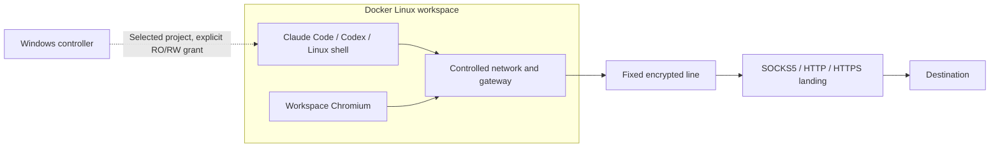

<h1 align="center">ENGE SPX</h1>

<strong>An isolated AI coding workspace for Windows</strong>

Run Claude Code, Codex and a workspace browser in Linux containers with a chosen, verified proxy exit.

<a href="README.md">简体中文</a> · <strong>English</strong> · <a href="https://github.com/engeeeee/ENGE-SPX/releases/tag/v0.15.1-windows">Download</a>

[Official website](https://enge1337.cn/) · [Website source](website/README.md)

**ENGE SPX brings AI coding tools, a workspace browser and proxy routing into one Windows desktop workflow.** Select a project, configure a route, review the exits, then open your tools. Commands run inside Linux containers while your selected project stays on your own disk and your preferred terminal hosts the interactive window.

It is intended for people who want to reduce exposure of their everyday Windows environment, keep workspace dependencies and browser data separate, and control how the workspace reaches external services. You supply the AI accounts, line and landing proxies.

## Core capabilities

| Capability | What it provides |
| --- | --- |
| **Containerized coding tools** | Claude Code, Codex and Linux commands run in containers with the selected project mounted, keeping tool dependencies apart from everyday Windows applications |
| **A workspace browser** | Sandboxed Chromium with persistent login data separate from the host browser; optional identities isolate Cookie, Storage and authorization |
| **Identity and project grants** | Independent tool accounts, browser data and downloads per identity; explicit read-only/read-write project grants, with legacy shared mode preserved |
| **A fixed line-to-landing chain** | A supported encrypted first hop followed by a SOCKS5, HTTP or HTTPS landing proxy, plus an explicitly labeled local-v2ray compatibility mode |
| **Exit review and monitoring** | Separate first-hop and final-exit checks, explicit confirmation before use, and environment shutdown when monitoring detects a connection, exit or topology problem |

This diagram shows managed chaining. The browser does not mount the project or tool-account volume. Other host directories are not mounted by default.

## Interface preview

**Start from one workspace dashboard.** Prepare the runtime, review the selected route and exits, then open your project and tools. Opening the app checks status; you choose when Docker starts.

| Projects, identities and tools | Lines and landing proxies |
| --- | --- |
|  |  |
| Select a local project, apply an identity and read-only/read-write grant, then use the tool and browser controls after connection confirmation. | Import nodes, choose a managed fixed chain or local-v2ray compatibility, and configure the line, landing and download proxy separately. |

These are actual **0.13.2 native Windows UI captures** using temporary data without accounts, proxy nodes or a running Docker workspace. Click an image for full size. [Capture provenance and reproduction](docs/screenshots/README.md) includes the source commit, Windows run and image hashes. The UI is currently Chinese.

## Typical uses

- Run Claude Code or Codex on Windows with container-managed Linux dependencies, a workspace browser and your existing project directory.
- Add a stable landing proxy behind a supported encrypted line, or reuse your existing local v2ray client as the first-hop transport.
- Limit the directories exposed to tools, review the actual workspace exits and stop the environment when detected conditions change.

## Download and start

Current release: **[0.15.1 stable](https://github.com/engeeeee/ENGE-SPX/releases/tag/v0.15.1-windows)**. Windows x64 requires Docker Desktop with Linux containers / WSL 2 and Docker Engine 28+. Packaged builds do not require a separate Python installation. Executables are currently unsigned.

**0.15.1 stable** fixes startup confirmation after an automatic timezone change and the timezone selector's labels/values. It includes workspace timezone selection from the verified final exit, plus in-app stable-release checks, verified downloads and restart-to-update for Windows installer and portable builds. Manual timezone remains available; existing project layers and accounts stay in place. Caption clicks restore Acrylic correctly and tool badges follow the chosen tint. Recheck and confirm the exit after upgrading. See [implementation, reproducible probes and validation limits](docs/terminal-appearance-performance.zh-CN.md). See [Smart Clipboard](docs/smart-clipboard.zh-CN.md), [release notes](docs/releases/0.15.1.zh-CN.md) and [validation scope](docs/validation-smart-clipboard.zh-CN.md).

- **[Windows installer](https://github.com/engeeeee/ENGE-SPX/releases/download/v0.15.1-windows/ENGE-SPX-Windows-x64-0.15.1-Setup.exe)**: per-user setup with shortcuts.
- **[Portable ZIP](https://github.com/engeeeee/ENGE-SPX/releases/download/v0.15.1-windows/ENGE-SPX-Windows-x64-0.15.1-Portable.zip)**: extract everything, run `ENGE-SPX.exe` and keep `_internal` beside it.
- Both packages contain `spx.exe`. Checksums and the matching runtime are on the release page.

1. Install [Docker Desktop](https://docs.docker.com/desktop/setup/install/windows-install/) once and complete its license, WSL and Linux-engine initialization.
2. Click **一键准备环境** in ENGE SPX. It starts the installed Desktop, waits for actual readiness, then reuses or installs matching runtime images.
3. Add a landing and choose a managed encrypted line or the local-proxy compatibility mode.
4. Check the route, review both exits and the time zone, confirm, then select a project and open a tool.

Opening ENGE SPX only checks status. Docker starts after you click **一键准备环境** or **启动并检测**, including when upgrading from older auto-start settings. The first runtime download is about 1 GB and starts after you click; existing images are reused. Download progress is visible and cancellation preserves data. There is no need to handle the runtime archive manually. The UI is currently Chinese; see the [quick start](docs/quickstart.zh-CN.md) and [installation troubleshooting](docs/installation-troubleshooting.zh-CN.md).

## Use your existing line and landing

| Mode | When to use it | Control and limitations |
| --- | --- | --- |
| **Managed chaining, recommended** | Import a supported encrypted share link and select the landing separately | ENGE SPX configures the fixed chain without DIRECT or automatic fallback. Domain-based line servers require their IPv4; TLS verification and SNI are preserved |
| **Local v2ray compatibility** | Keep the existing client or use a transport not supported by the importer | The external client controls per-destination routing to the landing. Matching diagnostic exits cannot prove that every destination followed the same route |

With the first hop disabled, the host connects to the landing; this does not provide a fixed encrypted first hop. ENGE SPX does not rewrite the Windows system proxy. A system-level TUN may still change the outer path to the line server.

| Protocol | Supported scope |
| --- | --- |
| SOCKS5 / HTTP / HTTPS | Authenticated or unauthenticated landings; HTTPS verifies certificates and names |
| VLESS | TLS TCP, WebSocket, gRPC, Reality / TCP Vision |
| Trojan | TLS TCP, WebSocket, gRPC |
| VMess | AEAD TCP, optional TLS, WebSocket and gRPC; unencrypted configurations cannot serve as encrypted first hops |
| Shadowsocks | AEAD / 2022 TCP |
| Hysteria2 | Real QUIC/UDP, a fixed server port, optional salamander; can precede a SOCKS5 / HTTP(S) landing |

Import URI/Base64 lists, JSON, common Clash/Mihomo YAML, local files or explicitly fetched HTTPS subscriptions. Imports extract nodes; they do not execute imported DIRECT, groups, fallback or DNS policies. Unsupported parameters and chains are rejected. Reality validates the public key and SNI; Hysteria2 needs a working UDP path. See [protocol limits](docs/proxy-p1.zh-CN.md), [proxy configuration](docs/proxies.zh-CN.md) and [line protection](docs/line-protection.zh-CN.md).

Runtime and subscription downloads use a separate local download proxy. Selecting proxy downloads fails if the proxy is unavailable; direct downloads require explicitly disabling the option. Source builds use Docker Desktop's networking.

## Isolation and its boundaries

- **Files and privileges**: projects use explicit read-only/read-write grants, with read-write preserved in legacy shared mode. Read-only still permits reading secrets; read-write permits changes and deletion. Tool containers do not mount Docker's management interface; capabilities are dropped and `no-new-privileges` is enabled.
- **Accounts and browser data**: the workspace browser profile is separate from the everyday host browser. Accounts and browser data are separate per explicitly selected identity and shared within that identity. Legacy shared mode retains existing logins. Separate data directories create independent managed instances; changing projects alone does not change identity.
- **Network paths**: tools use an internal network and gateway. Managed chaining has no direct fallback; local compatibility still depends on the external client's routing and the service providers.
- **Monitoring**: changes stop the environment when detected. IP monitoring has an interval and request timeouts, so exit changes are not detected instantaneously.

Starting with 0.8.3, ENGE SPX requires Chromium namespace and Seccomp-BPF sandbox evidence, and protects application proxy settings with Windows current-user DPAPI. Existing 0.8.2 packages and images require upgrading to receive these changes. See [sandbox, credentials, migration and explicit rollback](docs/security-hardening.zh-CN.md).

Containers depend on the host, Docker and WSL. DPAPI does not protect against malicious code running as the same user, host administrators or Docker administrators; tool-account and browser-profile volumes still need private storage and backups. The application has not had an independent security audit or full acceptance testing on the user's Windows + Docker Desktop + v2ray + custom terminal combination. It does not guarantee anonymity, speed or account acceptance. Read the [security model](docs/security-model.zh-CN.md) for the full scope.

## Terminal, downloads and storage

[Smart Clipboard Paste](docs/smart-clipboard.zh-CN.md) is included in 0.15.1: Ctrl+V in the existing Claude/Codex TUI can paste text, screenshots and file references without an upload dialog or automatic submission. Full clipboard bridging requires the owned smart terminal. Explicit Windows Terminal, PowerShell and custom terminal preferences keep their original behavior. Image delivery requires live native-image acknowledgement; compatible updates are no longer blocked by an exact version allowlist; see the [validation status](docs/validation-smart-clipboard.zh-CN.md).

The native Qt interface uses warm charcoal surfaces and muted clay accents,
with consistent controls and custom title bars. Pages are built on first use,
unchanged state is not repeatedly rewritten, and navigation adapts to narrow
windows. The complete name and main action are checked at multiple DPI scales.
System file pickers remain native.

Automatic selection uses the smart terminal for GUI Claude/Codex sessions; shell and login windows continue to select Windows Terminal, PowerShell 7, then Windows PowerShell. All third-party terminals use the same custom executable and argument template. The selected terminal hosts the window; tools still run in their container.

Downloads support pause, resume, speed/progress display, SHA-256 and exact image-recipe validation. App configuration, logs and download caches can move to another drive. Docker's images, containers and volumes use a separate disk-migration assistant and require applying the move in Docker Desktop. Project and program directories remain separate. See [storage and terminal settings](docs/storage-terminal.zh-CN.md).

## Resources, browser and exit

Set CPU and memory limits separately for the gateway, session, CLI projects and Chromium, including a budget for the current project. Choose normal or low-resource mode; limits are not reservations, and small budgets may slow compilation.

- **Understand usage**: distinguish application processes, owned containers, Docker Desktop and WSL2. These readings are not additive.
- **Reduce idle work**: open Chromium on demand or stop it separately while keeping the CLI running. Low-resource mode delays browser startup by default.
- **Measure your session**: start resource recording explicitly, or run bounded final-chain HTTPS timing/download tests and export redacted reports. These do not measure AI response time or a line maximum.
- **Choose how to exit**: X hides to the tray. Genuine **退出软件** / Ctrl+Q stops this workspace and waits for host services. Optionally save a preference to close Docker Desktop too. If Desktop was already closed, verified local cleanup completes the exit; if only Desktop confirmation fails, a one-time app-only exit preserves the saved preference.

Network safety monitoring runs independently of the resource page. Keeping the workspace while exiting the interface remains an explicit, confirmed option under the tray's More menu. See [resources](docs/resources.zh-CN.md), [recording](docs/field-recording.zh-CN.md), [network measurement](docs/network-measurement.zh-CN.md) and [exit behavior](docs/exit.zh-CN.md).

## Documentation and community

Most detailed guides are in Chinese:

| Topic | Guide |
| --- | --- |
| Installation and first workspace | [Quick start](docs/quickstart.zh-CN.md) |
| Protocols and routing | [Proxies](docs/proxies.zh-CN.md) · [Line protection](docs/line-protection.zh-CN.md) |
| Common questions and security | [FAQ](docs/faq.zh-CN.md) · [Security model](docs/security-model.zh-CN.md) |
| Upgrading existing data | [Migration](docs/migration.zh-CN.md) |
| Separate identities and project grants | [Workspace profiles](docs/workspaces.zh-CN.md) |
| CPU/memory, recording and diagnostics | [Resources](docs/resources.zh-CN.md) · [Recording](docs/field-recording.zh-CN.md) · [Network checks](docs/network-diagnostics.zh-CN.md) |
| Reports and contributions | [Support](SUPPORT.md) · [Contributing](CONTRIBUTING.md) · [Security reporting](SECURITY.md) |

## Development and status

Maintained by [engeeeee](https://github.com/engeeeee). Source use requires Python 3.12+ with PySide6 / Qt. Install with `python -m pip install -e .` and launch `spx`, or use `Start-Windows.cmd` on Windows. Windows packaging uses PyInstaller and Inno Setup. See [development instructions](docs/development.md), [0.8.2 lease, proxy, font and download validation](docs/validation-0.8.2.zh-CN.md) and [CHANGELOG](CHANGELOG.md).

The current focus is Windows x64, controlled proxy paths and existing-data compatibility. Windows installer and portable builds support in-app stable-release updates; there is no Windows ARM64 package. XHTTP/KCP, gRPC multi-mode, plugins and port hopping remain unsupported; see the [protocol matrix](docs/proxy-p1.zh-CN.md).

## License and attribution

The project uses [PolyForm Noncommercial 1.0.0](LICENSE). It is source-available under a noncommercial license, not an OSI open-source license. Separate branding does not remove third-party obligations. See [NOTICE](NOTICE.md) for provenance and [THIRD_PARTY_NOTICES](THIRD_PARTY_NOTICES.md) for component terms.
