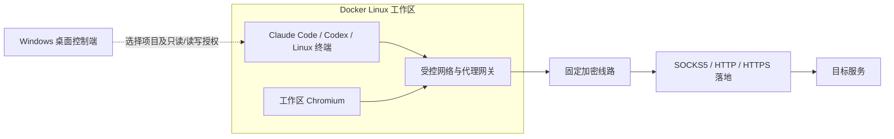

<p align="center"></p>
<h1 align="center">ENGE SPX</h1>
<p align="center"><strong>Windows 上的 AI 编程隔离工作台</strong></p>
<p align="center">为 Claude Code、Codex 和浏览器提供容器工作区，以及可指定、可核对的代理出口。</p>
<p align="center">
  <a href="https://github.com/engeeeee/ENGE-SPX/releases/tag/v0.15.1-windows">下载 Windows 版</a> ·
  <a href="https://enge1337.cn/">官方网站</a> ·
  <a href="#界面预览">界面预览</a> ·
  <a href="docs/quickstart.zh-CN.md">快速入门</a> ·
  <a href="docs/security-model.zh-CN.md">隔离与安全</a> ·
  <a href="README.en.md">English</a>
</p>
<p align="center">
  <a href="https://github.com/engeeeee/ENGE-SPX/actions/workflows/ci.yml"></a>
  <a href="https://github.com/engeeeee/ENGE-SPX/releases/tag/v0.15.1-windows"></a>
  <a href="https://github.com/engeeeee/ENGE-SPX/releases/tag/v0.15.1-windows"></a>
  <a href="LICENSE"></a>
</p>

**ENGE SPX 让你在 Windows 上建立一套与日常环境分开的 AI 编程工作区。** Claude Code、Codex 和 Chromium 实际运行在 Linux 容器内，由桌面程序统一准备环境、配置代理、核对出口和启动工具。

你只需选择项目、配置线路与落地、确认出口，再进入工作区。工具依赖和工作区浏览器资料留在容器环境中，所选项目仍保存在你自己的电脑上。它适合既想使用 AI 编程工具，又希望**缩小本机文件暴露范围、控制代理路径，并在连接异常时停止工作环境**的使用者。

## 核心功能

| 核心功能 | 作用 |
| --- | --- |
| **容器化 AI 编程工作区** | 在 Linux 容器中运行 Claude Code、Codex 和终端命令，只挂载选中的项目目录，减少工具依赖与 Windows 日常环境的混用 |
| **工作区专用浏览器** | 通过沙箱 Chromium 完成登录与授权，浏览器资料与本机日常浏览器分开；可选择独立身份，分别保存 Cookie、缓存和登录态 |
| **身份隔离与项目授权** | Claude/Codex 账号、浏览器资料和下载按身份分开；项目可显式授权只读或读写，默认共享模式兼容旧资料 |
| **固定线路＋落地代理** | 将加密线路与 SOCKS5 / HTTP / HTTPS 落地串联；软件内双跳不配置 DIRECT 或自动回退，也支持外部 v2ray 客户端接入 |
| **双出口核验与异常停止** | 分别检查线路出口和落地出口，由你确认后启用；运行期间检测连接、出口和拓扑变化，发现异常后停止本环境 |

这些能力组成一个完整工作流：**准备隔离环境 → 配置代理路径 → 核对出口 → 打开项目与工具**。工作区浏览器负责环境内的网页登录，桌面终端负责承载交互窗口，编程命令仍在容器中执行。

## 界面预览

**工作台：从准备环境到确认出口，在一个入口完成。** 打开软件先查看状态，何时启动 Docker、准备环境和启用连接，由你决定。


| 项目工作区：选择项目、身份和工具 | 连接与代理：分别管理线路和落地 |
| --- | --- |
| [](docs/images/0.13.2/2x/workspace.png) | [](docs/images/0.13.2/2x/connection.png) |
| 选择本地目录，应用身份和只读/读写权限；连接确认后，从同一页面打开 Claude Code、Codex、Linux 终端与工作区浏览器。 | 导入或添加节点，选择软件内双跳或本机 v2ray 兼容模式，配置线路服务器、落地和下载代理。 |

截图为 **0.13.2 真实程序在 Windows 原生环境中的运行画面**，使用未配置账号与节点的临时数据，展示配置入口。点击图片可查看原图；[截图来源与复现](docs/screenshots/README.md)记录了源码版本、Windows CI 和文件校验信息。

## 适合哪些场景

- **在 Windows 使用 Claude Code / Codex**：把 Linux 工具依赖、账号资料和工作区浏览器集中管理，保留本机项目目录和熟悉的终端。
- **已有线路，还需要固定落地**：在软件内组合受支持的加密线路与落地，或继续使用本机 v2ray，将它作为前置中转。
- **希望减少对日常环境的暴露**：只把必要项目交给容器，使用独立浏览器资料，并检查工作区的实际网络出口。

AI 服务账号、线路和落地代理由你提供。软件只管理这套工作环境，不提供账号、节点或速度与匿名保证。

## 工作区如何运行



图示为推荐的 **软件内双跳**。Windows 运行控制界面和终端窗口，Linux 容器运行工具与浏览器；浏览器不挂载项目目录或工具账号卷。项目容器按授权访问你选择的真实目录，其他本机目录不主动共享。

## 下载并开始使用

新增 **[Smart Clipboard 智能粘贴](docs/smart-clipboard.zh-CN.md)**：在自有终端的 Claude Code / Codex 当前输入区 Ctrl+V 粘贴文字、截图和文件，无额外上传对话框、不自动发送。完整功能需要智能粘贴终端；显式 Windows Terminal / PowerShell / 自定义终端保留原有行为。图片按当前会话的原生附件标记确认，兼容记录与限制见[验证记录](docs/validation-smart-clipboard.zh-CN.md)。

当前版本为 **[0.15.1 正式版](https://github.com/engeeeee/ENGE-SPX/releases/tag/v0.15.1-windows)**。支持 Windows x64，需要 Docker Desktop 的 **Linux containers / WSL 2** 后端，Docker Engine **28+**。安装版和便携版均不需要另装 Python。

本版修复自动时区检查通过后卡在“代理设置已更改”的问题，并纠正时区模式下拉框的显示与保存。保留跟随最终落地出口的自动时区，以及软件内检查、下载校验和重启更新。保留手动时区，已有环境可在停止后切换，项目与账号数据保留。修复终端单击标题栏后玻璃效果未恢复的问题，工具标签随配色变化。升级后重新检查并确认出口，保留原有字体、智能粘贴和网络保护功能。实现、复现脚本与验证边界见[终端外观与性能](docs/terminal-appearance-performance.zh-CN.md)。见 [发布说明](docs/releases/0.15.1.zh-CN.md)、[智能粘贴使用](docs/smart-clipboard.zh-CN.md)与 [验证范围](docs/validation-smart-clipboard.zh-CN.md)。

| 下载方式 | 适合谁 |
| --- | --- |
| **[Windows 安装版](https://github.com/engeeeee/ENGE-SPX/releases/download/v0.15.1-windows/ENGE-SPX-Windows-x64-0.15.1-Setup.exe)** | 常规使用；当前用户安装，提供开始菜单和桌面快捷方式 |
| **[Windows 便携版](https://github.com/engeeeee/ENGE-SPX/releases/download/v0.15.1-windows/ENGE-SPX-Windows-x64-0.15.1-Portable.zip)** | 自行管理程序目录；完整解压后运行 `ENGE-SPX.exe`，保留 `_internal` |
| **[发布记录与 SHA-256](https://github.com/engeeeee/ENGE-SPX/releases/tag/v0.15.1-windows)** | 查看改动、校验文件与同版本资产；两个 Windows 包均包含 `spx.exe` 命令行入口 |

1. **安装一次 Docker Desktop**：按 [官方安装说明](https://docs.docker.com/desktop/setup/install/windows-install/)完成许可、WSL 和 Linux 引擎初始化。
2. **点击“一键准备环境”**：软件自动启动已安装的 Docker，等待引擎就绪，再复用已有运行环境，或下载、校验并导入。
3. **配置线路与落地**：添加 SOCKS5 / HTTP / HTTPS 落地，按需选择软件内双跳或本机 v2ray 兼容模式。
4. **核对出口并开始编程**：检查线路、落地出口和时区，确认后选择项目，打开 Claude Code、Codex 或 Linux 终端。

首次运行环境约 **1 GB**，在软件内获取即可，无需手工处理 Releases 中的 runtime 归档。**打开软件只检测状态，由你点击后才启动 Docker 和准备工作区**；准备进度可见，可以取消，已有下载和数据保留。

详细步骤见 [快速入门](docs/quickstart.zh-CN.md)，安装失败见 [安装排障](docs/installation-troubleshooting.zh-CN.md)。

## 如何使用自己的线路和落地

已有 v2ray 线路、只需要增加 SOCKS5 落地时，可按线路协议和管理方式选择下面两种接入方式。线路服务器与线路出口不是同一个概念，落地出口也会单独检查。

| 模式 | 适用情况 | 路径由谁控制 |
| --- | --- | --- |
| **软件内双跳（推荐）** | 能导入受支持的加密线路分享链接，希望由软件固定第一跳和落地 | ENGE SPX 配置固定的“加密线路 → 落地”，不包含 DIRECT 或自动回退；域名线路需填写服务器 IPv4，保留原 TLS 名称与证书校验 |
| **本机代理（v2ray 兼容）** | 希望保留现有客户端，或线路使用当前软件尚未支持的传输方式 | 本机 v2ray 等客户端负责到落地的前置路径；ENGE SPX 负责后续工作区链路与出口检查，外部目标分流仍需你正确配置 |

也可关闭前置线路，仅使用所选落地；此时本机会连接落地，不具备固定加密第一跳的保护。软件不修改 Windows 系统代理，可以与本机 v2ray 同时运行。系统级 TUN 仍可能改变连接线路服务器的外层路径。

支持的节点与传输方式：

| 协议 | 支持范围 |
| --- | --- |
| **SOCKS5 / HTTP / HTTPS** | 认证或无认证落地，HTTPS 保留证书和名称验证 |
| **VLESS** | TLS TCP、WebSocket、gRPC，以及 Reality / TCP Vision |
| **Trojan** | TLS TCP、WebSocket、gRPC |
| **VMess** | AEAD TCP、可选 TLS、WebSocket、gRPC；未加密配置不能用作加密第一跳 |
| **Shadowsocks** | AEAD / 2022 TCP |
| **Hysteria2** | 实际 QUIC/UDP 传输、固定服务器端口，可选 salamander；可作为第一跳连接 SOCKS5 / HTTP(S) 落地 |

导入支持 URI / Base64 列表、JSON、常见 Clash / Mihomo YAML、本地文件和主动获取的 HTTPS 订阅。**只提取节点，不执行导入文件里的 DIRECT、分组、自动回退或 DNS 策略。** 不支持的参数和链路组合会明确拒绝；Reality 校验必要的公钥与 SNI，Hysteria2 需要 UDP 路径可达。

参数与组合限制见 [协议说明](docs/proxy-p1.zh-CN.md)，操作示例见 [代理配置](docs/proxies.zh-CN.md)，两种接入模式的边界见 [线路保护](docs/line-protection.zh-CN.md)。

**工作区代理与下载代理分别配置。** 运行环境和订阅可使用本机下载代理；勾选代理下载后，不可用时停止，不自动改为直连。源码构建的镜像拉取使用 Docker Desktop 自己的网络。

## 隔离带来了什么

| 层面 | ENGE SPX 的做法 | 需要了解的边界 |
| --- | --- | --- |
| **文件与进程** | 工具在 Linux 容器中运行，按需挂载项目；不挂载 Docker 管理接口，移除 capabilities 并禁止新增权限 | 默认共享模式为读写，可显式只读；只读仍能读取项目密钥，读写允许修改或删除 |
| **浏览器资料** | Chromium 使用独立持久 profile，不自动继承日常浏览器登录态，也不挂载项目或工具账号卷 | 同一身份内共享资料；需要不同账号时创建并绑定不同身份，切换项目不自动切身份 |
| **网络路径** | 工作容器使用内部网络和受控网关；软件内双跳固定线路与落地，诊断入口只在网关回环监听 | 外部 v2ray 兼容模式仍依赖客户端分流；代理服务商是信任边界 |
| **连接确认** | 启用前核验出口，运行后持续监测，检测到异常时停止环境 | 监测有周期和请求超时，不能承诺瞬间发现出口变化 |

0.8.3 起强制验证 Chromium 命名空间与 Seccomp-BPF 沙箱，Windows 应用代理配置使用当前用户 DPAPI 加密；旧 0.8.2 包和旧镜像需要升级后才具备这些机制。升级、兼容条件和显式回滚见 [沙箱与凭据保护](docs/security-hardening.zh-CN.md)。

容器依赖 Docker / WSL 和宿主机，不等同于与本机完全隔离的独立电脑。项目需要版本管理与备份，宿主机和所用服务仍需可信。DPAPI 不保护已被控制的宿主、同账户恶意程序或 Docker 管理端，工具账号和浏览器资料卷仍需妥善保管。

完整机制、数据位置和风险见 [隔离与安全模型](docs/security-model.zh-CN.md)。当前 Windows 包未代码签名，项目未经过独立安全审计，也未完成用户实机组合的全流程交互验收。

## 终端、下载和存储

| 功能 | 日常使用中的作用 |
| --- | --- |
| **原生桌面界面与自定义标题栏** | 暖深灰与陶土橙；页面、控件和弹窗统一样式，按缩放与窗口宽度布局，保留最小化、最大化、还原和边缘缩放 |
| **自己的终端** | 默认 Windows Terminal / PowerShell，第三方终端统一使用自定义 exe 和启动参数；窗口由你的终端承载，工具继续在容器内运行 |
| **下载与校验** | 显示速度和进度，支持暂停、断点续传，导入前检查 SHA-256、文件大小与镜像配方 |
| **应用数据跨盘迁移** | 将配置、日志和下载缓存迁到 D 盘等自选目录，复制后校验，保留安装标识与部分下载 |
| **Docker 数据盘迁移助手** | 记录资源，指导你在 Docker Desktop 迁移数据盘，恢复后核验原镜像、容器和数据卷 |
| **已有数据与命令行** | 复用匹配镜像和原有项目、账号、浏览器数据；可用 `spx start` 准备与检查，再用 `spx confirm` 确认 |

应用数据迁移与 Docker 数据盘迁移是两项独立操作，项目原目录也各自保留。操作与恢复见 [存储与终端设置](docs/storage-terminal.zh-CN.md)，旧版接管见 [升级说明](docs/migration.zh-CN.md)。

## 资源、浏览器与退出

**按需要分配资源，不必让所有组件一直运行。** 网关、会话、CLI 项目和 Chromium 可分别设置 CPU、内存上限，当前项目也可使用独立预算。正常模式与低资源模式可选；上限不是内存预留，低预算可能影响编译速度。


| 你想做什么 | 在哪里操作 |
| --- | --- |
| **看清资源花在哪里** | “资源与性能 → 占用概览”区分应用进程、本实例容器、Docker Desktop 和 WSL2，占用不能简单相加 |
| **减少闲置开销** | 选择低资源模式，或关闭“随工具自动启动浏览器”；需要时再打开 Chromium，亦可“停止浏览器 · 保留 CLI” |
| **记录实际使用过程** | 在“实机记录”手动开始资源采样，或在“网络检查”按需测试最终链路 HTTPS 首字节耗时与有界下载速率，导出脱敏报告 |
| **留在后台或真正退出** | X 隐藏到托盘；托盘右键或 Ctrl+Q 真正退出时默认停止工作区，也可在设置中选择同时正常关闭 Docker Desktop |

Docker 已手动关闭时，软件核实状态后完成收尾；工作区已停止、只有 Desktop 关闭确认失败时，可仅本次退出 ENGE SPX。网络安全监测按原规则独立运行，不随资源页隐藏而关闭。

详见 [资源预算](docs/resources.zh-CN.md)、[实机记录](docs/field-recording.zh-CN.md)、[测速范围与单位](docs/network-measurement.zh-CN.md)和 [退出流程](docs/exit.zh-CN.md)。测速不是 AI 请求速度或线路极限带宽；长时使用步骤见 [Windows 实机验收](docs/windows-acceptance.zh-CN.md)。

## 常见问题与文档

Windows 负责桌面控制，工作区实际是 Linux 容器。项目按只读/读写授权挂载；可在项目工作区创建独立身份，分别保存工具账号和浏览器资料。默认共享兼容旧版，同一身份内仍共享账号。独立数据目录适合进一步分开节点、时区及整个实例。

明确保留工作区退出界面的选项位于托盘“更多”，需要确认；重新打开软件可继续管理。[常见问题](docs/faq.zh-CN.md)解释代理、共享和迁移范围。

| 你要做什么 | 对应文档 |
| --- | --- |
| 第一次安装、启动与配置 | [快速入门](docs/quickstart.zh-CN.md) |
| 导入代理、选择协议与双跳模式 | [代理配置](docs/proxies.zh-CN.md) · [线路保护](docs/line-protection.zh-CN.md) |
| 了解隔离、数据位置与信任边界 | [隔离与安全模型](docs/security-model.zh-CN.md) · [常见问题](docs/faq.zh-CN.md) |
| 处理安装、下载或凭据工具错误 | [安装排障](docs/installation-troubleshooting.zh-CN.md) |
| 自定义终端、迁移数据到 D 盘 | [存储与终端](docs/storage-terminal.zh-CN.md) |
| 更新 Codex / Claude、查看工具退出错误 | [工具更新与终端](docs/tool-updates.zh-CN.md) |
| 分开账号身份、设置项目访问权限 | [工作区身份与项目授权](docs/workspaces.zh-CN.md) |
| 控制资源、记录占用或诊断网络 | [资源预算](docs/resources.zh-CN.md) · [实机记录](docs/field-recording.zh-CN.md) · [网络检查](docs/network-diagnostics.zh-CN.md) |
| 处理托盘退出和 Docker 联合关闭 | [退出流程](docs/exit.zh-CN.md) · [0.13.6 验证](docs/validation-0.13.6.zh-CN.md) |
| 反馈问题、提交贡献或报告漏洞 | [支持指南](SUPPORT.md) · [贡献指南](CONTRIBUTING.md) · [安全报告](SECURITY.md) |

## 项目状态与开发

由 [engeeeee](https://github.com/engeeeee) 个人维护，当前重点是 Windows x64、受控代理路径和已有数据兼容。当前未提供 Windows ARM64 安装包；XHTTP/KCP、gRPC multi-mode、插件和跳端口等尚未支持，具体范围以[协议说明](docs/proxy-p1.zh-CN.md)为准。

源码需要 Python 3.12+，界面依赖 PySide6 / Qt：

```powershell
python -m venv .venv
.\.venv\Scripts\python.exe -m pip install -e .
.\.venv\Scripts\spx.exe
```

Windows 包使用 PyInstaller 和 Inno Setup 构建。CI 覆盖 Windows / Linux 检查、GUI 与安装卸载、真实 Linux Docker 链路及两种镜像存储；[0.8.2 验证记录](docs/validation-0.8.2.zh-CN.md)列出了后台续期、转发、字体与中文、下载核验结果和实机验收范围。源码结构与构建见 [开发说明](docs/development.md)，版本变化见 [CHANGELOG](CHANGELOG.md)。

## 许可与来源

本项目使用 [PolyForm Noncommercial 1.0.0](LICENSE)，属于**非商业许可的源码公开项目**，不属于 OSI 定义的开源许可。独立品牌和仓库不会移除来源与第三方义务；历史说明见 [NOTICE](NOTICE.md)，组件条款见 [THIRD_PARTY_NOTICES](THIRD_PARTY_NOTICES.md)。
